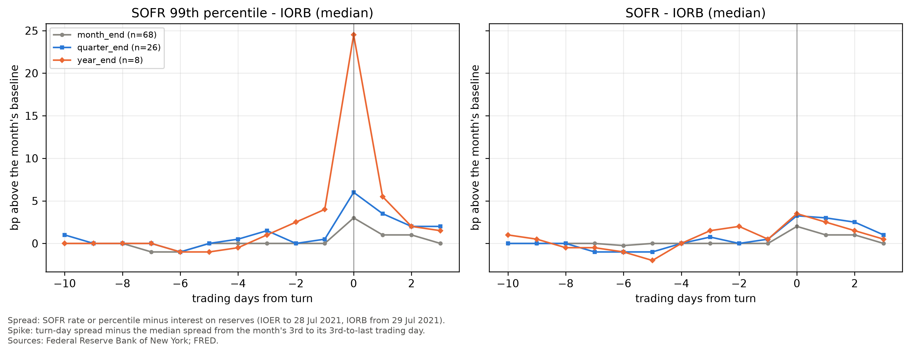
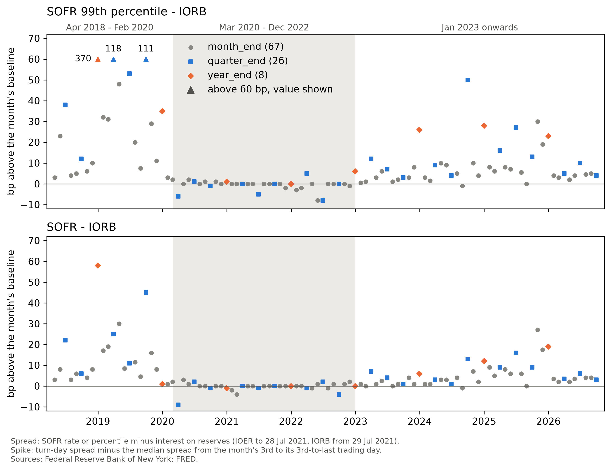

# Reserve Ampleness

Financial institutions, depending on their role, are subject to various kinds of financial regulations. The regulations require that financial institutions periodically report snapshots of their balance sheets. The reporting frequency, depending on the type of the financial institution, could be monthly, quarterly or yearly, with the snapshots being taken on the last day of the period. Financial institutions shrink their balance sheets on reporting dates, and overnight repo rates jump. This project asks how much of the size of that jump can be predicted from publicly available data on reserves and balance sheets.

### First Results

Spike = turn day SOFR (99th percentile) spread above the IORB (or IOER before 29 July 2021) minus the within month baseline of that spread in basis points. Data from 2nd April 2018 to 15th October 2026.

| Turn type | Turns | Median spike (bp) |
| --- | --- | --- |
|Month end | 67 | 3.0 |
|Quarter end (March, June, and September) | 26 | 6.0 |
|Year end | 8 | 24.5 |

One month end, 31 May 2019, has no published percentiles and is left out.




The spike happens on the turn day itself, with little build-up, and is mostly gone within two days. The 99th percentile jumps more than the headline rate, most of all on year-ends.



Spikes were close to zero from March 2020 to Dec 2022.

Median spike in the SOFR 99th percentile by period, in bp, with the number of turns in brackets:

| Period | Month end | Quarter end | Year end |
|---                    | ---:      | ---:      | ---:  |
|Apr 2018 - Feb 2020    | 10.0 (15)  | 53.0 (5)   | 202.5 (2)  |
|Mar 2020 - Dec 2022    | 0.0 (22)   | 0.0 (9)    | 1.0 (3)   |
|Jan 2023 onwards       | 4.2 (30)   | 9.5 (12)   | 26.0 (3)   | 

The year-end cell in the first row averages two very different turns: 370bp in 2018 and 35bp in 2019.

To reproduce the tables above: `python -m reserve_ampleness.reports.turn_facts`

To generate the figures above: `python -m reserve_ampleness.reports.figures`


### Status

As of 20th October 2026:

Done

- Data pulls for the New York Fed reference rates (SOFR, TGCR, BGCR, EFFR, OBFR, including SOFR percentiles and volumes) and for FRED series (IOER, IORB, ON RRP take-up, reserve balances). Each pull is saved as a dated snapshot with a manifest recording the URL, parameters, pull time and SHA-256.
- Loaders that check the data as they read it (duplicate dates, volumes must nest (SOFR $\geq$ BGCR $\geq$ TGCR), ordering of the SOFR percentiles), and a policy-rate series spliced from IOER and IORB.
- A calendar of the 102 month-end turns from April 2018 to September 2026 (68 ordinary month-ends, 26 quarter-ends, 8 year-ends), with the number of nights each overnight trade spans.
- A within-month baseline for measuring each spike: the median spread over the month's 3rd to its 3rd-to-last trading day.
- Exploratory notebooks, including an event study of SOFR around turns.
- `turn_facts.py` and `figures.py` giving median spikes on turn days and plots respectively.

Next

- A panel joining the rates to weekly reserve balances and daily ON RRP, aligned to publication dates: every predictor enters only if it was published before the forecast date.
- The remaining public predictors: primary-dealer positions and financing (FR 2004), the Treasury General Account and bill supply (Daily Treasury Statement), and standing repo usage.
- Out-of-sample forecasts of turn spikes, scored against naive benchmarks such as "same as the last turn of the same type".

### Layout

```
DATA/RAW/                         dated snapshots, their manifests, and registry.json
DATA/INTERIM/, DATA/PROCESSED/    empty for now
SRC/reserve_ampleness/data/       fetchers and loaders
SRC/reserve_ampleness/features/   turn calendar and monthly baseline
SRC/reserve_ampleness/reports/    turn_facts.py, figures.py for the tables and figures above
FIGURES/                          all generated figures
NOTEBOOKS/                        exploratory notebooks (outputs are stripped on commit)
TESTS/                            empty for now
```

### Setup

```
conda env create -f environment.yml    # creates the reserve-ampleness environment and installs this package in editable mode
conda activate reserve-ampleness
python -m reserve_ampleness.reports.turn_facts

```

The committed data is enough to reproduce the result. To pull fresh data:

```
python -m reserve_ampleness.data.nyfed_fetch_rates --start 2000-01-01 --end "YYYY-MM-DD"
python -m reserve_ampleness.data.fred_fetch_series --series-id IORB --start 2000-01-01 --end "YYYY-MM-DD"
python -m reserve_ampleness.data.fred_fetch_series --series-id IOER --start 2000-01-01 --end "YYYY-MM-DD"
python -m reserve_ampleness.data.fred_fetch_series --series-id RRPONTSYD --start 2000-01-01 --end "YYYY-MM-DD"
python -m reserve_ampleness.data.fred_fetch_series --series-id WRESBAL --start 2000-01-01 --end "YYYY-MM-DD"
```

The FRED pull needs an API key in a file called `fredapi.env` at the repository root, containing `FRED_API_KEY=...`; the file is ignored by git. After a pull, point `DATA/RAW/registry.json` at the new snapshot.

### Data Sources

- Federal Reserve Bank of New York, reference rates: [https://www.newyorkfed.org/markets/reference-rates](https://www.newyorkfed.org/markets/reference-rates)
- FRED, Federal Reserve Bank of St. Louis 


This product uses the FRED® API but is not endorsed or certified by the Federal Reserve Bank of St. Louis.